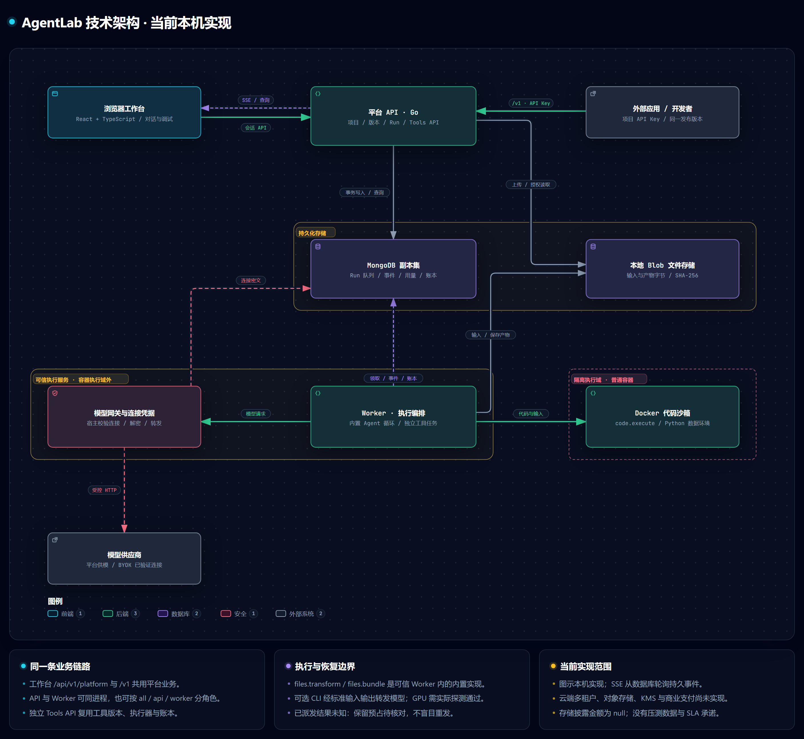
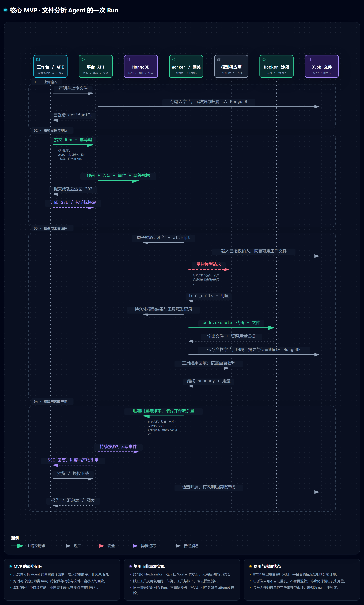

# AgentLab

AgentLab 的新方向是托管 Agent 执行与 Tools API 平台：用户通过工作台或 API 运行隔离任务，自选平台模型或自己的模型，获取产物、运行记录与分项费用。

**托管 Agent / Tools API 与黑色工作台主业务已在本机实现并验证**（项目、API Key、文件、Agent 运行、独立 Tools API、预算与账本、产物），见下文“托管 Agent / Tools API”与 [最新 P0 验收](docs/implementation-status.md)。工作台已接入真实接口，并使用真实模型与 Docker 容器跑通主链路；云端多租户、对象存储、受管凭据服务、商业支付与 SLA 均未实现。旧学习/资料管理源码与数据保留。

本机验收记录在 `assets/p0-acceptance.json` 与 `assets/design-validation.json`；实际范围、未知指标和未实现能力以实施现状为准。测试结果不等于商业支付、供应商最终账单或云端安全认证。

按文档完整 MVP 条款复核，本机主链路与前端接入已完成；验证只在本地运行，不依赖远程 CI。真实模型质量、云端多租户、商业支付与 SLA 不属于本机通过范围；逐项状态见 [MVP 核心需求复核](docs/implementation-status.md#mvp-核心需求复核2026-10-24)。

## 演示视频

[观看中文女声配音成片（约 2 分 52 秒）](assets/demo-voiceover.mp4)

视频展示 Agent、模型与沙箱配置、代码任务提交、已有天气卡片产物预览、运行记录、项目 API 密钥创建及用量管理。成片包含同步字幕与章节转场，输入过程以 3 倍速播放；天气卡片使用模拟演示数据，完整 API 密钥已遮挡。

[独立配音音轨](assets/demo-voiceover.mp3) · [SRT 字幕](assets/demo-captions.srt)

## 技术架构

以下两张图由 Archify 按当前源码生成，展示本机已实现的技术链路。云端多租户、对象存储、KMS 与商业支付的规划见[平台总设计](docs/agentlab-platform-design.md)，当前实现边界见[实施现状](docs/implementation-status.md)。

### 平台整体架构

React + TypeScript 工作台与外部应用通过两套入口访问同一 Go 平台业务。MongoDB 副本集保存业务状态、Run 队列、事件、用量与账本；Worker 领取租约后编排执行，模型请求在容器执行域外转发，代码在无网 Docker 沙箱中运行，文件字节写入本地 Blob 存储。

[](docs/diagrams/agentlab-platform.png)

[SVG 矢量版](docs/diagrams/agentlab-platform.svg)

### 核心 MVP 技术链路

以文件分析 Agent 的内置引擎为例：上传文件后，提交指定版本、模型、费用上限与幂等键；预算预占、Run 入队、首条事件和幂等凭据在同一事务内提交，成功后返回 `202`。Worker 经模型与工具循环生成产物，追加用量并按证据结算；工作台或 API 客户端通过 SSE 查看进度、预览和下载结果。图中纵向位置表示逻辑顺序，不表示实测耗时。

[](docs/diagrams/agentlab-mvp.png)

[SVG 矢量版](docs/diagrams/agentlab-mvp.svg)

对话每轮创建同类 Run，跨轮保存消息与文件，容器按轮回收。`files.transform` 与 `files.bundle` 在可信 Worker 内执行；独立 Tools API 复用工具和账本，跳过模型循环。已派发的未知结果保留预占待核对，不盲目重发或退款；BYOK 模型费由客户承担。

仓库页面直接显示从 Archify 交互版截取的高清 PNG，点击图片可查看原图。交互版与图源保留在本机 `.archify/`，不随仓库提交。[图表来源与重新生成说明](docs/diagrams/README.md)。

## 文档入口

- [平台总设计](docs/agentlab-platform-design.md)：产品、Agent API、Tools API、模型接入、计费、权限、架构与路线。
- [平台接口契约](contracts/platform.openapi.yaml)：已实现的托管 Agent / Tools API（`/v1`），由 `pnpm check:platform-contract` 对真实响应核对。
- [黑色极客视觉规范](DESIGN.md)：目标配色、布局、控件、运行与账单交互。
- [实施现状与迁移边界](docs/implementation-status.md)：已有代码与未来目标的区别。
- [演示操作与口播脚本](docs/demo-script.md)：按当前对话入口编排的逐屏操作、可复制指令、完整台词及 API/工具扩展片段。
- [本地启动与 MVP 视频脚本](docs/local-start-and-mvp-video.md)：从本机启动到录制最小真实主链路的逐步说明。
- [黑客松演示与协作](docs/hackathon-guide.md)：能演示什么、不能宣称什么、队友适合补哪些文档。
- [预设 Agent 与工具目录](docs/preset-agents.md)：9 个平台预设 Agent、3 个工具版本，以及演示时怎么选。
- [当前代码地图](docs/code-map.md)：工作台、平台后端、两套 API 和改完跑什么。
- [共用开发规则](AGENTS.md) / [如何提变更](CONTRIBUTING.md)：Codex / OpenCode 入口与提交时的检查。
- [品牌状态](assets/brand.json) / [目标设计变量](assets/design-tokens.target.json)：仅元数据，本轮未写入前端 CSS。

旧教育商业闭环、桌面架构与分散设计文档已移除，由上述入口统一替代。当前 OpenAPI 和程序启动方式仍以现有代码为准。

## 仓库结构

| 目录              | 当前用途                                                        |
| ----------------- | --------------------------------------------------------------- |
| frontend/         | React + TypeScript 黑色工作台；对话、项目、运行、产物与用量界面 |
| backend/          | Go 平台 API、任务与工具编排、预算账本、沙箱执行；保留历史业务   |
| contracts/        | 本地 /api/v1 契约（openapi.yaml）与托管平台 /v1 契约            |
| runtime/          | Linux guest、OpenSandbox、CLI/MCP 的开发验证资产                |
| docs/             | 总设计、实施现状、技术图、演示说明、预设目录与代码地图          |
| assets/           | 品牌元数据、目标 tokens、验收证据与演示成品                     |
| scripts/          | 现有开发、构建与检查编排                                        |
| compose.test.yaml | 本地 MongoDB 单节点副本集                                       |

Hydro/、OpenSandbox/ 是被忽略的上游参考目录；.cache/、.tools/ 和 build/ 为本地工具或产物，不作为产品规范。

## 现有工程环境

Node 22.20.x（见 .node-version）、pnpm 9.15.9、Go 1.26.x（见 backend/go.mod），本地数据库使用 Docker Compose。Windows 桌面运行需要 WebView2；其他桌面平台须另验构建依赖。

默认 Node 16 无法运行当前前端工具。本机可在 PowerShell 当前会话选择已安装版本，不修改全局配置：

```powershell
$env:PATH = 'D:/node/nvm/v22.20.0;' + $env:PATH
node --version
pnpm --version
pnpm install --frozen-lockfile
go -C backend mod download
```

其他机器使用自己的 Node 22 路径。锁文件定义具体依赖，不从文档中另选版本。

## 启动当前本地原型

```powershell
pnpm db:up
pnpm seed:demo
```

随后在两个终端分别启动：

```powershell
# API：http://127.0.0.1:8787
pnpm dev:api

# 前端：http://127.0.0.1:5173
pnpm dev
```

数据库必须是可用的 MongoDB 副本集；连接失败时应用拒绝启动。当前 HTTP API 仅允许本机 loopback，不是可直接开放公网的云服务。

模型账户可以在当前侧栏“账户连接”中添加并验证。兼容已有开发配置时，显式使用 pnpm dev:api --env-file .env.dev；普通启动不自动读取该文件。秘密不得提交到仓库或写入运行日志。

需验证真实 guest 时先执行 pnpm build:guest。执行器默认检查真实能力，AGENTLAB_LEARNING_EXECUTOR_READY=0 供关闭执行器的普通回归使用。缺少执行器不会阻止保存资料，但不能通过 mock 状态假装实际运行成功。

停止本地数据库并保留数据卷：

```powershell
pnpm db:down
```

## 托管 Agent / Tools API

用户侧从工作台“对话”开始：预选 Agent、模型和沙箱后，在聊天框里发消息、上传文件并继续追问。回复与折叠执行进度增量更新，产物卡片可打开预览。消息历史与文件由后端保存，每轮启动并回收容器，不在等待下一条消息时持续占用；每次发送按显示的费用上限预占。普通用户登录默认进入对话，Agent 页面仍提供 API 调试与完整 Run 记录。

后端 MVP 在 `backend/internal/platform`：开发者用 API Key 上传文件、提交 Agent 运行或直接调用工具，订阅事件、取回产物并核对用量与账本。同一组操作有两个入口：`/v1`（API Key，可单独监听用于公网）和 `/api/v1/platform`（工作台会话）。完整契约见 [contracts/platform.openapi.yaml](contracts/platform.openapi.yaml)。

### 在本机运行

```powershell
pnpm db:up
pnpm build:sandbox     # 代码沙箱镜像（首次需联网下载基础镜像与 Python 库）
pnpm seed:demo         # 演示账号
pnpm seed:platform     # 开发用价格表：仅供本地验证计量，不是商业定价
pnpm dev:api --env-file .env.dev
```

平台模型来自 `BASE_URL` / `API_KEY` 导入的共享连接：在工作台“账户连接”验证后才可用，并应在导入之后再执行 `pnpm seed:platform`，价格表才会覆盖它的模型。没有沙箱镜像或 Docker 时，`GET /capabilities` 报告 `codeExecution=false` 与原因，代码执行被拒绝，不会退回到宿主执行。

#### GPU 与代码 Agent 引擎（可选）

```powershell
pnpm build:sandbox:cuda     # 在 CPU 沙箱之上加 PyTorch 2.7.1+cu118 与 scikit-learn（约 3 GB）
pnpm build:sandbox:agents   # 在 CPU 沙箱之上加 Node 22、git、ripgrep 与固定版本的 pi / OpenCode / Codex CLI / Claude Code
$env:AGENTLAB_SANDBOX_GPUS = "0"                                         # 可租用的 NVIDIA 显卡序号；留空即不开放 GPU
$env:AGENTLAB_SANDBOX_GPU_IMAGE = "agentlab/sandbox-python-cuda:20261025"
$env:AGENTLAB_SANDBOX_AGENT_IMAGE = "agentlab/sandbox-agents:20261025"
$env:AGENTLAB_SANDBOX_CPUS = "4"; $env:AGENTLAB_SANDBOX_MEMORY_MB = "8192" # GPU 规格需要 4 vCPU / 8 GiB
```

在同一个 PowerShell 窗口执行 `pnpm dev:api --env-file .env.dev`，这些设置才会传给新启动的 API 进程。也可将以下配置写入根目录 `.env.dev`，之后通过同一启动命令加载；修改后需重启 API：

```dotenv
AGENTLAB_SANDBOX_GPUS=0
AGENTLAB_SANDBOX_GPU_IMAGE=agentlab/sandbox-python-cuda:20261025
# 可选：代码 Agent 引擎，需先构建对应镜像
AGENTLAB_SANDBOX_AGENT_IMAGE=agentlab/sandbox-agents:20261025
AGENTLAB_SANDBOX_CPUS=4
AGENTLAB_SANDBOX_MEMORY_MB=8192
```

代码 Agent 引擎需要显式配置 `AGENTLAB_SANDBOX_AGENT_IMAGE`；即使 Docker 中已有镜像，未配置时仍会提示“此部署没有可用的代码 Agent 沙箱镜像”。GPU 默认关闭；“此执行节点没有开放 GPU”表示 API 进程没有收到显卡序号配置。启动后会后台运行 CUDA 检查，短暂显示“正在检查”时稍后刷新即可。

- GPU：Docker 需带 NVIDIA 运行时（Docker Desktop + WSL2 已提供）。每张列出的卡先在 CUDA 镜像里跑一次真实矩阵运算，通过后才出现在规格里；规格按型号逐词匹配显卡名，GPU 按卡型计价、每次代码执行独占整卡，容器仍无网络、只读根、非 root。本机预设为 `gpu-rtx3070-laptop-4-8`（RTX 3070 Laptop），只有声明了 GPU 规格的 Agent 版本（如“GPU 计算 Agent”）能使用。
- 代码 Agent 引擎：“代码 Agent（可选引擎）”的运行可选 `harness`（`pi`、`opencode`、`codex`、`claude-code`）。CLI 在无网络的沙箱里运行整个任务，模型请求经容器回环地址上的转发器、通过标准输入输出到宿主机：宿主机校验请求、固定冻结的模型、限制输出 token、去掉路由/插件/服务端状态与付费服务端工具，用真实凭据转发并记录供应商用量后才把答复交给 CLI；沙箱里没有真实密钥或供应商地址。Codex CLI 只支持 Responses 协议、Claude Code 只支持 Anthropic Messages 协议，所用连接必须提供 `/responses` 或 `/messages`，否则请求被拒绝且不计费。会话期间容器一直占用所选规格，沙箱秒含模型等待。

在工作台创建项目、设置预算并签发 API Key（密钥明文只显示一次）后，开发者只需要 `/v1`：

```bash
KEY=al_live_...   # 创建密钥时显示的明文
API=http://127.0.0.1:8787/v1

# 1. 声明并上传文件（uploadUrl 已含 /v1 前缀）
curl -sS -X POST $API/files -H "Authorization: Bearer $KEY" -H "Idempotency-Key: demo-file-0001" \
  -H "Content-Type: application/json" -d '{"name":"orders.csv","size":<字节数>}'
curl -sS -X PUT "http://127.0.0.1:8787<uploadUrl>" -H "Authorization: Bearer $KEY" --data-binary @orders.csv

# 2. 选择 Agent 版本与可用模型，然后提交运行（202，立即返回）
curl -sS $API/agents -H "Authorization: Bearer $KEY"
curl -sS $API/models -H "Authorization: Bearer $KEY"
curl -sS -X POST $API/runs -H "Authorization: Bearer $KEY" -H "Idempotency-Key: demo-run-0001" -H "Content-Type: application/json" -d '{
  "agentVersionId": "...", "modelConnectionId": "...", "model": "...",
  "input": {"instruction": "按地区汇总订单金额并画图", "artifactIds": ["<文件 id>"]},
  "limits": {"maxCostMicros": "3000000", "currency": "CNY"}}'

# 3. 订阅事件（SSE，断线用 Last-Event-ID 续传），再取结果与产物
curl -sSN $API/runs/<run id>/events -H "Authorization: Bearer $KEY" -H "Accept: text/event-stream"
curl -sS "$API/artifacts?kind=output&runId=<run id>" -H "Authorization: Bearer $KEY"
```

金额一律是微单位的十进制字符串（1 元 = 1 000 000）并带币种；重试写请求时保持同一个 `Idempotency-Key`，返回的是原运行，不会重复执行或重复预占。

### 扩容与部署

- 进程角色由 `AGENTLAB_ROLE` 决定：`all`（默认，开发与小规模）、`api`（只服务 HTTP）、`worker`（只执行运行）。API 副本无状态，增加副本即增加请求容量；增加 worker 进程或 `AGENTLAB_WORKER_CONCURRENCY` 即增加并行运行数。运行由 MongoDB 中一次带索引的原子操作领取，租约与 attempt 令牌防止失联的 worker 覆盖新的执行者。
- 所有副本必须共享：同一个 MongoDB 副本集、同一个文件存储（目前是 `AGENTLAB_BLOB_DIR` 指向的共享目录；对象存储后端尚未实现）、同一个 `AGENTLAB_CREDENTIAL_KEY`（连接凭据解密与下载链接签名都由它派生）。执行 worker 的节点需要 Docker（或兼容 CLI）与沙箱镜像；`AGENTLAB_SANDBOX_SLOTS` 限制本节点同时运行的容器数，`AGENTLAB_SANDBOX_RUNTIME=runsc` 之类可换用 gVisor/Kata 加强隔离。
- `AGENTLAB_PLATFORM_LISTEN_ADDR` 另开一个只服务 `/v1`、`/healthz`、`/readyz` 的监听，只认 API Key、不读取浏览器 Cookie，用于放在 TLS 终结代理之后。`/readyz` 会真实运行一次沙箱容器，沙箱不可用时报告降级而不是假装可用。
- 优雅停止：收到 SIGTERM/Ctrl+C 后不再领取新运行，进行中的运行最多再获得 `AGENTLAB_DRAIN_SECONDS`（默认 90）完成，之后交给租约恢复；容器编排的终止宽限期应不短于它。
- 当前限制（详见 [实施现状 §7](docs/implementation-status.md)）：没有压测数据；限流按进程计数；排队是全局先进先出，没有按项目的公平调度；事件流以数据库轮询实现；隔离级别是普通容器。

## 本地演示账号

以下账号仅由显式 seed:demo 初始化创建，普通启动不插入账号。密码修改后再次初始化不会重置。它们属于当前原型，不是未来云服务默认账号。

| 角色   | 用户名  | 初始密码               | 当前历史入口 |
| ------ | ------- | ---------------------- | ------------ |
| 管理员 | admin   | AgentLab-Admin-2026!   | /#/admin     |
| 用户   | student | AgentLab-Student-2026! | /#/student   |

student 是保留的演示用户名，角色为 user，不表示新平台还采用教育角色。初始化会建立标明演示的旧资料，不生成虚构的评测、用量或消费记录。

## 当前配置

| 环境变量                              | 用途                                                                 |
| ------------------------------------- | -------------------------------------------------------------------- |
| AGENTLAB_MONGO_URI                    | 默认 mongodb://127.0.0.1:27018/?replicaSet=rs0&directConnection=true |
| AGENTLAB_MONGO_DATABASE               | 默认 agentlab；测试使用独立数据库                                    |
| AGENTLAB_LISTEN_ADDR                  | 默认 127.0.0.1:8787，仅数值 loopback                                 |
| AGENTLAB_API_PORT / AGENTLAB_WEB_PORT | Vite 代理和开发端口                                                  |
| AGENTLAB_DEV_ORIGIN                   | 额外获准的本机开发来源                                               |
| AGENTLAB_CREDENTIAL_KEY               | 宿主根密钥，32 随机字节的 Base64；不是前端环境变量                   |
| AGENTLAB_CREDENTIAL_KEY_FILE          | 可选宿主根密钥文件；默认用户配置目录                                 |
| AGENTLAB_CONNECTION_ALLOWED_ORIGINS   | 显式授权的私有/测试网关 origin                                       |
| BASE_URL / API_KEY                    | 兼容已有开发模型配置；启动时仅迁移一次为待验证连接                   |

原型的凭据密文保存于 MongoDB；Windows 根密钥受 DPAPI 保护。备份数据库还需单独保管原根密钥及必要的宿主保护信息，不能仅备份业务库。完整环境字段见 backend/.env.example。

## 检查与构建

下列命令作用于当前代码。本轮纯文档任务只核对文档与元数据，没有执行它们，也没有重启环境。

```powershell
pnpm contracts
pnpm check:platform-contract   # 需要 MongoDB；核对平台契约、真实响应与工作台类型
pnpm format:check
pnpm lint
pnpm --filter @agentlab/frontend check
pnpm check
pnpm build
pnpm build:desktop
```

前端类型从 OpenAPI 生成；Wails 资源由构建脚本复制，不手工修改。桌面构建产物不是已签名安装包。

真实数据库与浏览器检查：

```powershell
pnpm db:up
pnpm test:integration
pnpm --filter @agentlab/frontend exec playwright install chromium
pnpm test:e2e
pnpm test:e2e:live
```

托管平台还有两类需要真实依赖的检查：`pnpm test:sandbox`（先 `pnpm build:sandbox`）在真实容器里验证隔离、资源限额，并让 Agent 运行真实的 pandas/matplotlib 代码；`pnpm smoke:platform` 启动真实的服务进程，仅经公开 API Key 监听走完整条开发者链路；`go -C backend test -race ./internal/platform/...` 需要 C 编译器，本机缺少时在 Linux 容器内运行。

`pnpm accept:real-models` 是消耗真实额度的验收（约 0.005 美元）：用 `.env.dev` 里的真实供应商，对三款 Flash 模型各跑一次 CSV 与 Excel 分析、一次自带账户（BYOK）运行和独立工具调用，按产物内容判定结果，并核对用量、账本、预算、存储披露与秘密泄露；加 `--record` 会写出脱敏记录 `assets/p0-backend-acceptance.json`。模型输出不确定，每个场景最多两次尝试并全部记录。需要 MongoDB、Docker 与沙箱镜像，不进入 CI。

GPU 与代码 Agent 引擎另有真实检查：`pnpm test:sandbox:gpu` 在真实显卡上跑 CUDA 检查与隔离的 PyTorch 运算，并让“GPU 计算 Agent”端到端训练一个小模型、按卡型计费（需要 NVIDIA 运行时、两个镜像与 MongoDB）；`pnpm test:sandbox:sessions` 让四个 CLI 各在真实会话容器里对接脚本化模型，验证只经转发器取模型、工具在无网络沙箱内执行并交回文件（不消耗模型额度）；`pnpm accept:code-agents` 用 `.env.dev` 的真实供应商经公开 API Key 监听跑四个引擎与 GPU Agent，按产物内容判定，并检查沙箱环境变量里没有任何凭据（消耗少量真实额度，`--record` 写出 `assets/code-agent-acceptance.json`）。这些都不进入 CI。

普通浏览器回归和真实 guest 场景是不同门槛。可用 AGENTLAB_BROWSER_PATH 指定已有 Chromium。测试端口与数据库由现有配置隔离；测试结果不证明新版云平台或黑色界面已完成。

## 后续实施

按照总设计的 P0 → P1 → P2 推进：先完成托管任务/API 纵向链路，再迁移工作台和计量，最后验证云端试点与商业支付。当前课堂集合、接口和页面按单独迁移任务处理，不因文档改版直接删除。
