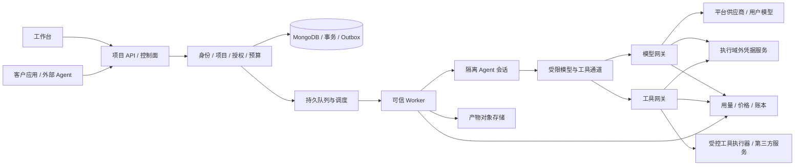

# AgentLab 托管 Agent 与 Tools API 平台总设计

版本 3.0 · 2026-10-24 · 状态：产品与工程目标已确定，待分阶段实施。

本文件是产品定位、业务规则、接口草案、架构与实施路线的唯一总设计。它替代旧编程教育商业闭环、桌面沙箱架构及分散的课堂设计。视觉规则见 [DESIGN.md](../DESIGN.md)，现有代码事实见 [implementation-status.md](implementation-status.md)，开发入口见 [README.md](../README.md)。

本文件定义目标，不因文档发布自动视为实现。当前本机平台 API、黑色工作台、真实模型/Docker 主链路已有代码和证据；完整 MVP 仍有收尾项，云端托管与商业支付按后续阶段验收，具体见实施现状。

## 1. 产品定位

AgentLab 为开发者、AI 应用团队和自动化服务商提供托管 Agent 执行与工具调用能力。用户通过工作台或 API 提交任务，自选平台模型、自己的供应商账户或自建模型服务；平台在隔离环境中执行，交付产物、进度、运行证据和可核对的费用。

产品表达：**选择模型与工具，托管执行任务，把运行能力接入自己的产品。**

工作台承担配置、调试、版本发布、运行观测和账单管理；Agent API 与 Tools API 是可集成、可计量的服务入口。编程教育、课程和判题退出主定位；旧功能仅作为原型和可复用工程资产。

### 1.1 目标客户与首个切入口

| 客户                      | 正在解决的问题                                   | 首版交付                                  |
| ------------------------- | ------------------------------------------------ | ----------------------------------------- |
| 小型 SaaS / AI 应用开发者 | 给自己的产品增加文件分析、数据处理与代码执行能力 | API、SDK 示例、项目额度、结构化结果与文件 |
| Agent / 自动化服务商      | 为不同客户隔离账户、运行任务、核对交付成本       | 客户项目、连接引用、版本与运行记录        |
| 使用自有模型的技术团队    | 已有推理服务，希望复用执行环境和工具             | 经授权的模型端点、托管执行和 Tools API    |

首个切入口为文件与数据任务：接收 CSV/Excel 等明确支持的格式，在独立工作空间内处理，生成结构化结果、报表或图表，并校验产物。格式清单、最大文件大小与支持范围由发布版本明确声明；不能把任意办公格式或 OCR 都列为首版已支持。

### 1.2 竞争与差异化假设

客户的替代方案包括自行组合模型与沙箱、调用其他执行基础设施、使用已有托管 Agent 服务。用户购买的是可集成的运行服务、可靠交付及运维便利。

首轮验证三个假设：

1. 工作台调试与 API 调用使用相同发布版本，可减少从试验到集成的重复工作。
2. 模型来源可切换，账户、工具权限、任务预算与费用证据保持一致，便于客户控制自己的技术栈。
3. 聚焦文件与数据任务，明确输入/输出契约、异常处理和成本，能比通用工具拼装节省持续维护成本。

一体化计费、多模型、沙箱和审批均不是天然壁垒。长期价值要由成功任务成本、工具适配质量、故障恢复、版本稳定性及客户持续调用验证。平台不宣称比所有通用办公 Agent 更聪明。

### 1.3 首版范围与非目标

首版目标：一组平台预设 Agent 模板（首个为文件分析，随后覆盖表格清洗、数据质量、报表图表和文档摘要）、代码执行与结构化文件处理两类工具、平台供模与用户 API Key 两种模型来源、异步 Run API、产物下载、项目预算和分项用量。

任意自定义 Agent 托管、浏览器工具、第三方 OAuth、长尾 MCP 市场、跨区域部署和商业支付分阶段接入，不与首版一起承诺。自定义 Agent 需要草稿、不可变版本、工具与资源权限、提示词/文件边界检查、发布审批和回滚证据；这些链路完成前，平台只发布经过验证的预设 Agent。首版不交付通用电脑接管、任意生产系统写操作、无限模型调用或自动安全认证。

## 2. 产品对象与权限

| 对象                                    | 职责与边界                                                         |
| --------------------------------------- | ------------------------------------------------------------------ |
| Tenant / Workspace                      | 客户数据、成员、余额与资源的隔离边界                               |
| Project                                 | API、Agent 发布、工具授权、连接引用、预算和产物的归属              |
| User                                    | 人的登录身份；账户角色保留用户与管理员，资源权限单独校验           |
| APIKey                                  | 机器调用身份；绑定租户、项目、操作范围、有效期和限额               |
| Connection                              | 模型或工具账户元信息与不透明秘密引用；不提供密钥导出               |
| Agent / AgentVersion                    | Agent 定义与不可变发布版本，包含执行逻辑、工具、输出 schema 和限制 |
| Tool / ToolVersion                      | 可独立调用的受控能力，包含输入/输出 schema、风险、计量和重试语义   |
| Run / Attempt                           | 一次任务及实际执行尝试；HTTP 重试不应创建重复业务任务              |
| ToolCall                                | 运行树中的一次工具操作，或独立 Tools API 操作                      |
| Session / Sandbox                       | 隔离运行资源与工作空间；销毁不删除账本与审计                       |
| Artifact                                | 输入与输出文件的对象引用、摘要、大小、归属和保留期                 |
| Grant / Approval                        | 资源授权及需人工决定的冻结操作，绑定版本和代次                     |
| UsageEvent / PriceVersion / LedgerEntry | 用量证据、不可变价格快照和只追加账本                               |

管理员不能导出用户秘密，也不能通过通用 CRUD 改写实际消耗、运行结果或账本。平台运维权限与客户管理员权限分离；诊断默认只提供脱敏运行信息。

所有查询、对象下载、回调与写操作都校验租户和项目。对象 ID、连接别名及 URL 本身不是授权。用户退出或 API Key 撤销的影响范围必须明确；授权撤销优先于尚未派发的外部操作。

## 3. 三种使用方式

### 3.1 工作台运行

创建项目 → 选择 Agent 模板 → 绑定模型与工具 → 上传材料 → 配置预算与输出格式 → 提交运行 → 查看进度和异常 → 审阅/下载产物 → 核对用量。

工作台不得给用户展示虚构的余额、成功率、任务、产物或“安全已验证”标记。未配置模型、缺少预算、连接到期、运行环境不可用分别提供明确原因。

### 3.2 Agent API 集成

用户在工作台调试并发布 AgentVersion，自己的应用通过项目 API Key 提交任务。长任务返回 run_id；调用方通过查询、事件流或签名回调获取状态，最终领取结构化结果和授权产物。

调用方可指定允许覆盖的模型连接和更小的预算；不能突破发布版本、API Key 或项目授予的模型、工具和资源上限。已发布版本固定，升级创建新版本；运行中的任务保持原版本。

发布版本固定 prompt/Skill 摘要、工具版本、镜像摘要、输出 schema、校验器和权限策略。Run 再冻结实际选择的模型、连接代次和价格，便于追溯与回归；供应商同名模型发生变化时保留实际返回标识，不能承诺上游永远不变。

### 3.3 独立 Tools API

用户可以只购买工具能力，把自己的 Agent 留在其他系统中。工具具有明确职责与计量单位；单次调用也可能异步，浏览器等工具还可能需要受控会话。

独立调用和 Agent 内部调用使用同一权限、版本与计量规则。Agent 内的 ToolCall 归入父 Run；不能把它再伪装为一个独立客户任务重复收取相同资源费用。

## 4. 模型与工具接入

### 4.1 模型来源

| 模式            | 模型成本                                   | 平台职责                                                 |
| --------------- | ------------------------------------------ | -------------------------------------------------------- |
| Platform        | 客户向 AgentLab 支付所选价格版本的模型费用 | 供应商连接、用量核验、额度、故障归类与对账               |
| BYOK            | 客户自行承担模型供应商账单                 | 托管账户引用、受限调用、用量记录；可另收透明的平台服务费 |
| Custom Endpoint | 客户自行承担自建模型成本                   | 协议与连通性验证、授权网络路径、超时及用量能力声明       |

“自己的模型”需区分供应商 API Key 与自建模型服务。自建端点可能不提供可信 Token 或账单，未知值保留 null；使用已披露的估算也不能标为供应商结算。

账户验证须检查已支持的认证与模型能力；保存配置不等于验证成功。当前实现只支持 OpenAI 兼容文本 Chat Completions；未来协议与工具调用支持按版本声明，不能无损互换或仅凭 URL 推断兼容。

平台供模采用正式服务接口与可核对用量，不把个人消费订阅、网页登录状态或共享登录文件当作商用 API 供给。供应商适用场景、结算方式和可用协议在接入时逐项核对。

### 4.2 账户保管与网络

真实模型、工具凭据留在执行域外。工作空间、项目文件、Agent 提示词和运行日志不接收真实秘密。执行环境通过受限、可撤销的通道访问模型与工具网关；连接只授予允许的项目、模型、工具、资源与有效期。

公网目标要求 HTTPS，拒绝跨 origin 携带认证重定向。校验发现地址、DNS 和实际拨号目标，阻断未授权内网、元数据和回环目标。私网模型通过显式网络连接与独立授权接入，不能将“自定义地址”变成任意网络代理。

当前本地凭据实现为 AES-GCM 密文与宿主根密钥，Windows 使用 DPAPI 保护根密钥；云端需要独立凭据服务、KMS/受管秘密存储、轮换、备份与租户隔离。云端能力尚待实施。

### 4.3 工具目录

首批已实现工具为 code.execute 和 files.transform，正式契约见 contracts/platform.openapi.yaml。文档提取、搜索、浏览器和业务连接器后续按需求接入。

每个 ToolVersion 必须声明：输入/输出 schema、允许目标、最大数据量、运行限制、权限、副作用、计量单位、价格版本、错误与重试语义。工具描述和结果是不可信数据，不能改变平台策略。

文件读取、目录列举、内部调度等基础步骤不额外包装为付费工具。付费工具必须有用户能理解的独立价值或明确的上游成本。MCP 只是工具接入协议之一；不把任意 MCP 安装命令直接授予执行器。

## 5. 目标 API 草案

以下为目标接口草案，统一使用 /v1 前缀。其中文件、运行、事件、取消、工具调用、产物、用量与账本已在后端 MVP 中实现，可调用契约见 [contracts/platform.openapi.yaml](../contracts/platform.openapi.yaml)；回调与签名投递、工具审批等尚未实现，以 [实施现状](implementation-status.md) 为准。仓库现有 contracts/openapi.yaml 仍描述本地 /api/v1 接口，两份契约相互独立。

| 接口                        | 目标行为                                            |
| --------------------------- | --------------------------------------------------- |
| POST /v1/files              | 初始化受限上传；校验完成后生成可引用的 Artifact     |
| POST /v1/runs               | 接收不可变 Agent 版本、材料引用与限制；202 返回 Run |
| GET /v1/runs/{id}           | 查询实际状态、结果引用与费用证据                    |
| GET /v1/runs/{id}/events    | SSE 增量事件与服务端游标                            |
| POST /v1/runs/{id}/cancel   | 请求停止后续执行；不承诺撤回已发生副作用            |
| POST /v1/tools/{name}/calls | 按固定版本调用工具；同步或 202 由该工具契约声明     |
| GET /v1/tool-calls/{id}     | 查询工具操作及未知状态                              |
| GET /v1/artifacts/{id}      | 校验归属后提供短时下载权限                          |
| GET /v1/usage               | 按项目、Run、工具和计量项查询用量                   |
| GET /v1/billing/ledger      | 查询预占、结算、释放与调整明细                      |

工作台的模型连接、项目、API Key、价格管理等接口后续单独补充。管理凭据的接口与执行数据面使用不同权限；执行身份不获得账户管理能力。

### 5.1 Run 请求与结果

示例仅说明业务字段，所有金额采用币种微单位的十进制字符串：

```json
{
  "agentVersionId": "agent_file_analysis_v1",
  "modelConnectionId": "conn_customer_model",
  "input": {
    "instruction": "合并上传表格，标记重复记录，生成汇总报表",
    "artifactIds": ["artifact_input_a", "artifact_input_b"]
  },
  "limits": {
    "maxExecutionSeconds": 300,
    "maxToolCalls": 20,
    "maxCostMicros": "1000000",
    "currency": "CNY"
  }
}
```

这些限制是示例输入，不是承诺价格、运行性能或现有支持范围。服务端计算实际可用权限和预算，不信任客户端提交的租户、费用、结果或成功状态。

Run 返回身份、状态、版本、时间、进度事件、产物引用、计量摘要与结构化错误。工具参数、秘密、完整源码和用户材料不默认出现在公开运行摘要中。

### 5.2 认证、幂等、事件与回调

- 机器 API Key 只在创建时展示一次，服务端保存摘要；密钥绑定项目、scope、到期时间、速率、并发与预算。撤销后禁止新调用并处理既有授权，不通过角色 Header 提权。
- 写操作要求 Idempotency-Key，范围为租户、项目、调用主体和操作；保存请求摘要。同键同内容返回原对象，同键不同内容返回 409。
- 默认不因 HTTP 429、超时、5xx 或客户端断线自动重发可能产生消耗/副作用的操作。客户端重试可查询原 Run，不创建新 Run。
- SSE 支持游标恢复；回调按至少一次投递设计，具备签名、时间戳、事件 ID、防重放、重试上限与手动补投。重复回调不重复执行或计费。
- 外部 API 不承诺端到端 exactly-once。已发生或结果未知的副作用需要原请求编号及对账证据。

## 6. 执行与状态

### 6.1 Agent 执行循环

接收输入并校验 → 固定版本与价格 → 预占预算 → 持久排队 → 领取租约 → 准备隔离会话 → 调用模型 → 校验工具请求与授权 → 执行工具 → 记录证据 → 继续或停止 → 校验产物 → 结算/待核对 → 交付。

这是真正的多步模型与工具循环。当前一次模型请求生成建议的路径不能被改名后就称为托管 Agent 已完成。

循环受最大时间、模型输出、工具次数、并发、数据量和费用限制。模型不能自行扩大权限、申请新账户、放宽网络或抬高预算。涉及外部写入等行为，按工具发布策略进入人工审批。

### 6.2 状态机

Run 生命周期：queued → preparing → running → succeeded / failed / cancelled / unknown。等待用户操作用独立 blockedReason 表达，并明确资源是否继续保留；取消请求先标记 cancelling，完成事实核对后进入最终状态。

ToolCall 分别记录 planned、waiting_approval、dispatched、succeeded、failed、unknown；结果未知的调用不能按普通失败自动退款或重试。

执行状态与结算状态分离：pending、estimated、settled、not_applicable。任务失败可能产生真实用量；任务完成也可能仍有供应商费用待核对。

### 6.3 调度与恢复

MongoDB 持久队列、租约、attempt 与 fencing 控制领取。任务状态、预占、审计与 outbox 在需要的业务事务中一起提交。事件投递失败可以补投，业务动作不能因此重复。

恢复先核对原会话、上游请求、授权代次和计量证据。已派发的未知操作保留预占，进入对账流程；不能因为 worker 重启就盲目重新执行。

同一 Run 内可以复用受控会话，跨租户、项目和授权代次不能借复用穿越边界。暂停、恢复、销毁、快照和产物保留分别定义；外部系统变更及账本不随沙箱快照回滚。

## 7. 费用与商业闭环

### 7.1 对客户的收费结构

**一次 Agent API 任务费用 = 平台供模费用 + 托管服务费 + 沙箱资源费 + 明示的付费工具/存储/网络费。** BYOK 不计平台模型费。工作台与 API 走同一预占、冻结价格和结算路径，不因多一次 HTTP 轮询收费。

新预设托管服务费只包含基础调度与观测，运行秒包含模型等待、不包含排队；沙箱按固定 CPU/内存/GPU 规格的实际隔离执行秒另列。每次执行不足一秒向上取整，计入宿主观测的启动与回收，不使用 guest 上报时长计费。旧 `execution` 价格默认已含算力，不能叠加沙箱费用；管理员显式发布 `sandboxBilling: separate` 的托管新版本后才切换为资源另列。

| 计费项    | 可选计量单位                             | 收费原则                                                           |
| --------- | ---------------------------------------- | ------------------------------------------------------------------ |
| 托管执行  | 固定规格运行秒/分钟，或真实 CPU/内存占用 | 发布明确计量口径；排队不计执行资源费，保留内存的等待是否计费须披露 |
| 平台模型  | 供应商支持的 Token、缓存、图像等维度     | 按锁定价格与有效证据计费；不同维度不可随意混算                     |
| 用户模型  | 平台可观测用量；模型费归客户承担         | 平台不重复收供应商模型费用；额外网关费须单独披露                   |
| 付费工具  | 页、请求、操作、会话资源等               | 由 ToolVersion 声明，内部基础步骤不额外收费                        |
| 存储/流量 | 保留容量、期限、出网量                   | 基础额度、保留期与超额规则明确列出                                 |

一套余额可以支付多项服务，但账单必须拆项。平台不能因为 Agent 调用 code.execute 就把同一段 CPU/内存费用收两遍。独立 Tools API 若采用包含算力的单价，不再叠加相同算力费；工具调度与第三方服务费用如另计，必须明示。

工具同样注明平台供给、客户账户或自建服务。客户自行支付上游工具费用时，平台服务费与上游估算分列，不能把上游直付成本再次列为平台应收。

不以模型价差作为唯一收入来源。平台价值通过托管、工具能力、可靠性和支持服务收费验证。首版不承诺无限调用、不编造价格、不宣称按成功结果收费可以消除失败成本。

#### 7.1.1 三款 Flash 模型的起始价格

2026-10-24 核对 [OpenRouter 模型接口](https://openrouter.ai/api/v1/models) 的 `pricing.prompt`、`input_cache_read` 与 `completion`，均为 USD/token；以下乘以百万后作为可发布的平台起始价。页面可能显示路由最低价，DeepSeek 接口另有高峰时段覆盖价；此表使用接口基础价作为固定平台价，不代表供应商按该价结算。运行中不抓取价格、不随上游时段变化浮动；更改须发布新价格版本。

| 模型 | 输入 USD / 百万 tokens | 缓存命中 USD / 百万 tokens | 输出 USD / 百万 tokens | 参考页面 |
| --- | ---: | ---: | ---: | --- |
| minimax/minimax-m3.1-flash | 0.15 | 0.015 | 0.60 | [MiniMax](https://openrouter.ai/minimax/minimax-m3.1-flash) |
| deepseek/deepseek-v4.1-flash-1017 | 0.15 | 0.003 | 0.60 | [DeepSeek](https://openrouter.ai/deepseek/deepseek-v4.1-flash-1017) |
| z-ai/glm-5.3-flash | 0.15 | 0.030 | 0.50 | [GLM](https://openrouter.ai/z-ai/glm-5.3-flash) |

人民币起始价采用固定换算 **1 USD = 7.20 CNY**，无加价；这是定价参数，不是实时外汇报价。金额存整数微单位。模型每步费用为 `ceil(((输入−缓存命中)×输入单价 + 缓存命中×缓存价 + 输出×输出单价) / 1,000,000)`，缓存数量包含在输入中，不能再重复计算；模型用量缺失进入待核对。当前只按文本 token 计价，图像、音频、视频等价格不据此推定。管理员共享渠道（tenant scope）按平台供模计费；私人连接按 BYOK。

#### 7.1.2 沙箱与托管服务的起始价格

以下是平台预设，非云厂商报价或已完成 GPU 能力承诺。CNY：每 vCPU 秒 100 微元、每 GiB 秒 25 微元、每 L4 秒 2,000 微元；USD：每 vCPU 秒 20 微美元、每 GiB 秒 5 微美元、每 L4 秒 400 微美元。GPU 必须按明确卡型定价，不能把不同卡统一视为一块 GPU。

| 资源规格 | vCPU | 内存 | GPU | CNY / 沙箱秒 | USD / 沙箱秒 |
| --- | ---: | ---: | --- | ---: | ---: |
| cpu-1-1 基础 | 1 | 1 GiB | 无 | 0.000125 | 0.000025 |
| cpu-2-4 标准 | 2 | 4 GiB | 无 | 0.000300 | 0.000060 |
| cpu-4-8 计算 | 4 | 8 GiB | 无 | 0.000600 | 0.000120 |
| gpu-l4-8-32（未开放） | 8 | 32 GiB | 1 × NVIDIA L4 24 GiB | 0.003600 | 0.000720 |

托管服务另按 CNY 0.000050 / 运行秒或 USD 0.000010 / 运行秒。Agent 内 `code.execute` 调度单价预设 0，算力只按所选规格计收；独立 Tools API 固定 1 vCPU / 1 GiB，每秒 CNY 0.000125 或 USD 0.000025，含算力，不叠加托管或沙箱费用。`files.transform` 处理费预设 0；内部文件读写不收费。价格为 0 的明确计费项与未知存储计量分开表达。

**存储（MVP 口径）**：每个项目每个 UTC 日采样一次仍在保留期内的文件，按 MiB·日（向上取整，不足 1 MiB 按 1 MiB）披露为 `storage` 类用量，状态 `not_applicable`、金额 null——含在基础额度内、不单独计费。这是披露，不是计费：目前没有存储价目、额度上限与超额规则，不能写成“已免费”或“已结算”，也不进入预算、账本或应付。要对存储收费，须先发布价目、额度与超额规则，并改用字节·秒级的计量，日采样粒度不足以计费。没有文件的项目没有存储用量行，而不是一行 0。

示例：CNY 项目使用 MiniMax，输入 10,000 tokens（含缓存命中 2,000）、输出 2,000，托管运行 120 秒，其中 2核4GiB 沙箱累计计费 30 秒，模型费 0.017496 元、托管费 0.006 元、沙箱费 0.009 元，合计 **0.032496 CNY**。实际按每步/每次执行的取整与冻结价格计算。选择了 GPU 模型不代表沙箱需要 GPU；两者独立。

管理员在“用量与账单 → 价格与资源规格”按渠道供应商标识发布缺失预设或发布新版本，也可显式运行 `go -C backend run ./cmd/seed-platform`。预设仅补缺失项，不覆盖已有或待生效管理员价格。Run 固定资源规格和价格 ID，节点按规格施加 CPU/内存限制；不可用规格拒绝提交。GPU 预设只用于规划，当前执行后端拒绝 GPU。执行已派发而用量未知时保留预占，等待核对，不按零资源费结算或盲目重发。

### 7.2 预占、结算与账本

新预算层级为租户总额、项目额度、调用身份额度和 Run 上限；并发与速率限制另外计算。不得机械沿用旧课堂的班级/学生预算字段。

本机 MVP 项目预算为累计额度，不按月重置；API Key 的月度上限是独立约束。人工核对追加独立结算证据与差额用量，原始用量记录保持不可变，查询关联证据显示当前结算状态。

调用前固定价格版本并按允许上界预占；实际用量确认后结算并释放剩余预占。未知价格维度或无法保守限制的操作先拒绝或要求明确上限。预算不替代供应商侧限额，超额实际消耗必须如实记录并阻断后续调用。

账本只追加 reserve、settle、release、adjustment，含操作与证据引用。用量按 provider request、ToolCall、attempt 和计量维度去重；父 Run 汇总子事件，不能再生成一笔重复消费。

金额以整数微单位保存，JSON 用字符串传输，显示币种。不同币种不合并成一个无来源余额；汇率换算另有明示规则和快照。供应商最终账单、平台账单、BYOK 估算和客户充值四者区分。

支付订单、通知验证、充值入账、退款、欠费、开票和税务处理均属于未来商业接入。现有预算账本不等于真实收款系统。

### 7.3 单位经济与验证

按任务类别跟踪收入减去模型、工具、计算、存储、流量、支付与支持等成本后的贡献毛利。失败、未知、重试及等待资源均计入实际成本分析。

首批试点关注接入耗时、持续调用、可用产物比例、复核时间、成功任务成本及支持负担。定价、免费额度和 SLA 在实测后发布；本文不使用竞品当前价格作为平台成本保证。

## 8. 目标架构与部署



浏览器工作台为主要控制面，桌面壳保留为本地调试/受信入口；首版商业平台不依赖客户安装桌面应用。HTTP 服务、worker、凭据域、对象存储与执行节点按信任边界部署。

工程延用 React + TypeScript、原生/语义 CSS、Go 和 MongoDB。Tailwind 仅映射统一设计变量；Monaco 与内容渲染按需加载。锁定版本以仓库依赖与 runtime 锁文件为准，不在文档中另造版本表。

开发/CI 保留 compose.test.yaml 的 MongoDB 副本集，不新增 SQLite。生产方案需要备份恢复、迁移、连接权限、可观测性和容量验收，单节点开发副本集不直接视为高可用。

当前 QEMU TCG + Linux guest + OpenSandbox execd 用于本地功能验证。商用执行节点必须测量隔离、启动延迟、并发、回收、冷暖池和单位成本；KVM/其他正式虚拟化的选择按这些结果落定，不将本地模拟器性能当作商用承诺。

### 8.1 主要数据集合（规划）

tenants、projects、project_memberships、api_keys、connections、grants、agent_versions、tool_versions、runs、attempts、tool_calls、sandbox_sessions、artifacts、approvals、usage_events、price_versions、budget_accounts、ledger_entries、outbox_events、webhook_deliveries、audit_logs。

业务查询使用租户/项目复合索引；发布版本和操作幂等使用唯一索引；worker 领取以状态、lease_until 和创建时间建立索引。文件正文进入受限对象存储，MongoDB 保留归属和摘要。秘密密文或秘密引用不进入通用可编辑配置集合。

这些集合是设计目标。后端 MVP 实际使用带 platform_ 前缀的集合（项目、成员、连接授权、API Key、Agent 与工具版本、价格、预算账户、账本、用量、Run、事件、工具调用、产物、幂等回执、集群锁），未实现 approvals、outbox_events 与 webhook_deliveries。现有 learning*\*、catalog*\* 等旧集合不会在本轮自动改名、删除或迁移。后续迁移必须提供映射、备份、兼容窗口与验证，不通过文档变更改写历史数据含义。

## 9. 工作台与视觉

一级导航规划为 Overview、Projects、Agents、Tools、Runs、Connections、API Keys、Usage & Billing、Artifacts、Settings。中文界面保留规范英文对象名与标识，文案围绕创建项目、运行、发布 API、查看产物和核对账单。

Run 详情重点呈现当前状态、停止入口、工具调用树、事件、产物、实际用量、费用拆项和待处理事项。API Playground 使用同一发布版本与权限；任何“试运行”都明确是否产生真实费用。

用户侧管理自己的项目与授权资源，管理员侧管理受托范围内的账户、策略和运营配置。旧课程、班级、学生、训练赛及家长门户不进入新导航。旧页面尚未被本轮删除，后续按迁移计划实施。

统一采用黑色极客风：近黑背景、石墨面板、电青主色、少量紫色强调、细边框、紧凑布局、清晰等宽数据与可读的日志。炫酷来自运行结构、状态与克制的光效；不使用软陶插图、奶油背景、厚重圆角和持续闪烁。完整规则以 [DESIGN.md](../DESIGN.md) 为准。

## 10. 安全与可靠性交付门槛

- 项目/API Key 权限不能被前端、Agent、工具描述、路径或对象 ID 绕过；跨租户读取与写入有负向验收。
- 执行节点不读取客户真实秘密，不开放默认外网直连或通用代理；故障时拒绝新增未验证能力。
- 工具写操作校验冻结参数、资源范围、版本、授权代次和审批；撤销后阻止新派发，已发生的动作如实记录。
- 产物校验路径穿越、链接、类型、大小和摘要。预览位于无账户能力的隔离上下文，不继承控制台或原生绑定权限。
- Worker 租约失效、取消、连接轮换、计量重复、回调重复与供应商未知结果有明确恢复路径。
- 不将日志完整性、隐私承诺、安全认证、全平台协议兼容或收费可用性作为未经验证的既成事实。

## 11. 实施阶段与验收

| 阶段                | 后续实施内容                                                                | 退出条件                                                              |
| ------------------- | --------------------------------------------------------------------------- | --------------------------------------------------------------------- |
| D0 文档重置（本轮） | 总设计、黑色视觉、规则、现状、目录与开发说明                                | 引用有效、旧规范不再生效；本轮不修改实现，并行代码改动单独记录        |
| P0 托管执行纵向链路 | 项目身份、API Key、一个 AgentVersion、两类工具、Agent 循环、异步 Run 与产物 | 外部应用经 API 完成真实任务；重复请求无重复业务执行；预算与证据可核对 |
| P1 工作台与计量     | 黑色界面迁移、调试/发布、运行树、用户模型、工具独立调用、费用拆项           | 工作台与 API 行为一致；权限、取消、未知结果与账本验收通过             |
| P2 云端试点         | 弹性执行节点、对象存储、受管凭据、支付与项目运营                            | 小规模客户持续调用，毛利与容量有数据，完成备份/故障演练               |
| P3 按需求扩展       | 私网模型、浏览器、OAuth、更多连接器及部署形态                               | 每项能力有客户需求、版本契约、成本和可靠性验收                        |

P0 状态（2026-10-25）：本机纵向链路已有真实 DeepSeek、MongoDB、Docker 容器、平台供模及私人 BYOK、无会话 API Key 调用和 CSV/PNG 产物证据。预算累计口径、用量只追加、本地工作台门槛、Excel 与原生缩放/键盘收尾已有实现和验证；真实供应商三模型、存储策略、工作区信息与 Agent 数量的后端部分已由独立任务验收，记录在实施现状文末（工作台尚未接入这些字段），不能因此宣称所有 P0 已关闭。证据和逐项状态见实施现状；云端执行节点、对象存储、受管凭据、支付、审批与回调不因本机链路通过而视为实现。

测试分开验证：纯业务与协议、MongoDB 事务、工具与供应商协议、真实隔离执行、工作台交互和商业对账。mock 不能替代真实执行验收；成功构建不能替代能力上线证明。

## 12. 仓库迁移规则

现有产品代码、API 契约、MongoDB 集合、演示账号、图片与 CSS 本轮保留。新命名与新导航只在文档中确立。后续实现逐个迁移模块，不通过全局替换把学生改成项目、判题改成工具计费。

优先复用身份、连接保管、持久队列、幂等、预算、版本冻结、只追加记录与隔离执行；重新设计其租户/项目归属和对外身份。教育判题可作为内部结果校验的参考实现，不继续作为主业务扩展。

文档入口维持精简：本文件描述目标；implementation-status.md 描述代码事实；根目录 DESIGN.md 描述视觉；README 与各目录 README 提供实际开发说明；AGENTS.md 与 frontend/AGENTS.md 约束后续开发。出现冲突先校准事实与目标，不复制出新的平行设计。

## 13. 参考与待验证事项

以下为产品研究入口，不代表 AgentLab 已拥有相同能力；费率和服务条款须在选型时重新核对：

- [Browserbase Agent API](https://www.browserbase.com/agents) / [计费结构](https://www.browserbase.com/pricing)
- [E2B 执行环境文档](https://docs.e2b.dev/) / [资源计费](https://e2b.dev/pricing)
- [Composio 工具与授权](https://docs.composio.dev/reference) / [计费结构](https://composio.dev/pricing)
- [AWS AgentCore 计费](https://aws.amazon.com/bedrock/agentcore/pricing/)

尚待实测与客户验证：首批真实任务与付费意愿、稳定模型/工具组合、计费单位、错误与支持成本、云节点规格、并发与启动延迟、存储保留、供应商结算证据和正式 SLA。本轮不把这些未知项填成市场承诺。
